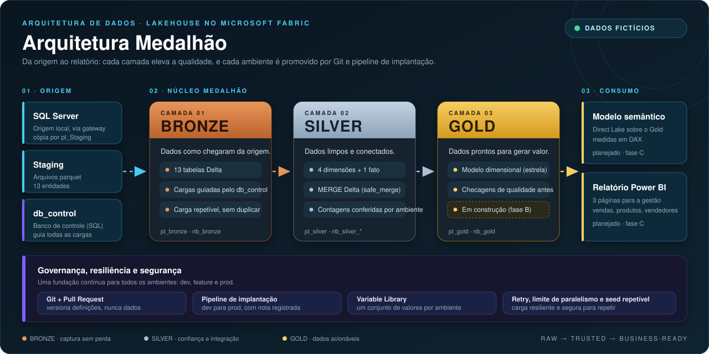
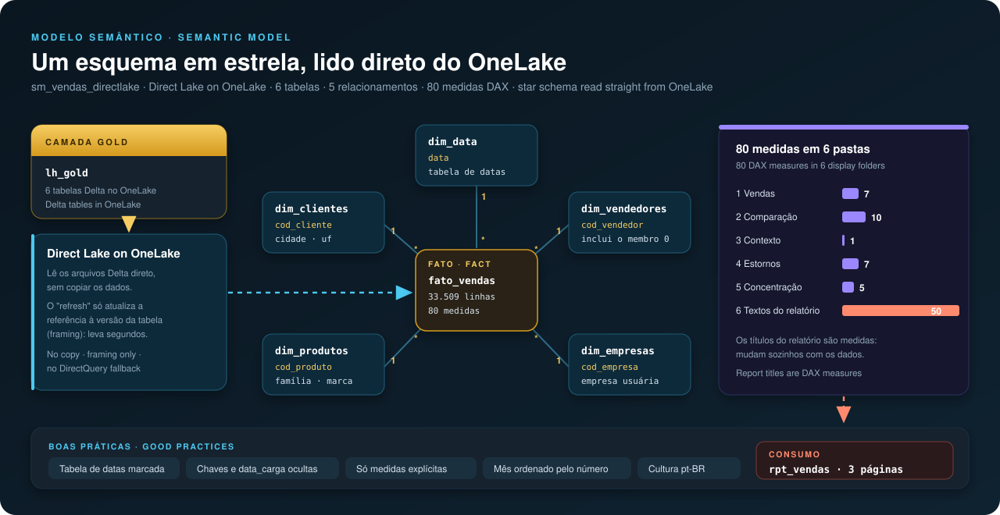
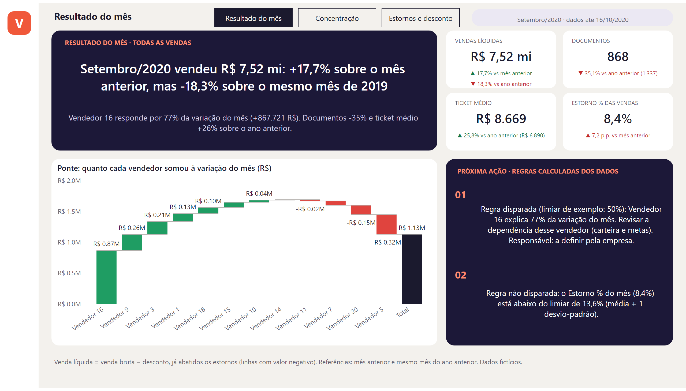
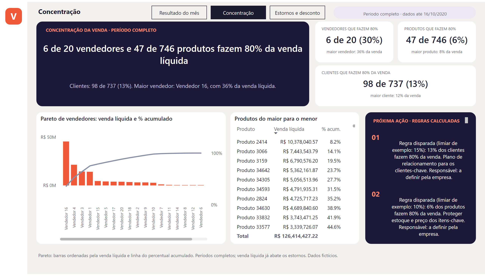
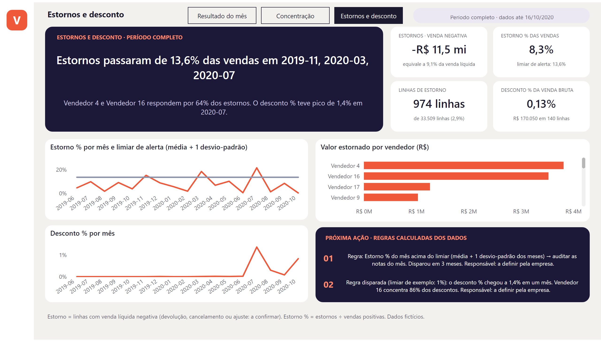
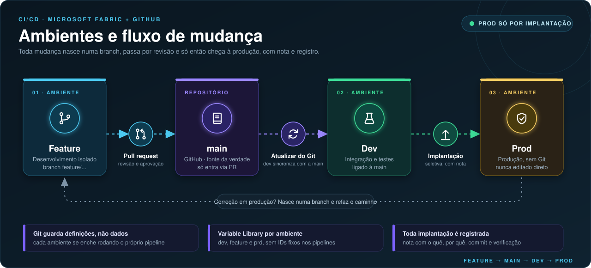
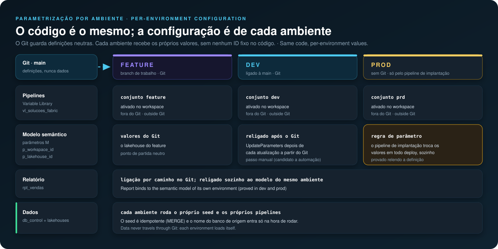
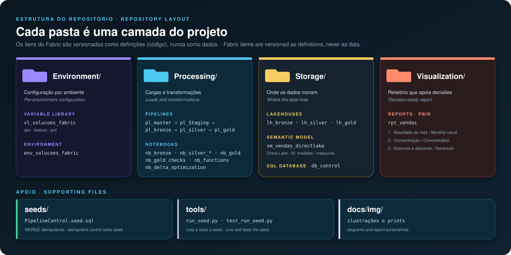

# sales-transformacoes-fabric

[Português](README.md) · **English**

End-to-end data engineering project on **Microsoft Fabric**: from a SQL Server source to a **Power BI report that answers business questions**. **Medallion** architecture (bronze, silver, gold), three environments (**dev, feature and prod**) and change promotion through **Git, pull requests and deployment pipelines**. All data is fictitious; the business vocabulary (table and measure names) is in Portuguese.

Load configuration does not come from a spreadsheet: it comes from a control table (`db_control`, a Fabric SQL Database). Loading a new table takes a new row in that table, with no code change.

## What is delivered

| Stage | Deliverable | Where |
|---|---|---|
| Ingestion and layers | Staging, Bronze, Silver and **Gold** (star schema) | `Processing/`, `Storage/Lakehouses` |
| Data quality | `nb_gold_checks`: 28 checks (keys, reconciliation with Silver, orphan sales, calendar) | `Processing/Notebooks` |
| Semantic model | `sm_vendas_directlake`: Direct Lake on OneLake, 6 tables, **80 DAX measures** | `Storage/Semantic Models` |
| Report | `rpt_vendas`: 3 pages that answer business questions | `Visualization/Reports` |
| Environments | dev, feature and prod with Git, pull requests and a deployment pipeline | see below |
| CI/CD automation | automatic pull request validation and approved deployments | in progress (phase D) |

## 1. Data architecture

<p align="center">
  
</p>

The pipelines (`pl_Staging`, `pl_bronze`, `pl_silver`, `pl_gold`) are orchestrated by `pl_master` and driven by `db_control`.

| Layer | What it holds | How it is built |
|---|---|---|
| Staging | raw copy of the source, as parquet | `pl_Staging` (Copy activity) |
| Bronze | Delta tables mirroring the source | `pl_bronze` + `nb_bronze` |
| Silver | cleaned data, dimensions and fact | `pl_silver` + `nb_silver_*` notebooks |
| Gold | star schema: `fato_vendas` (sales fact) + `dim_clientes`, `dim_produtos`, `dim_vendedores`, `dim_empresas`, `dim_data` | `pl_gold` + `nb_gold` (one generic notebook, driven by `db_control`) |

Reusable functions, such as `safe_merge` (idempotent incremental load), live in `nb_functions`. `nb_delta_optimization` maintains the Delta tables (OPTIMIZE with V-Order and VACUUM) using native Spark SQL only.

## 2. Loads driven by `db_control`

`seeds/PipelineControl.seed.sql` inserts the control rows (40 today: Staging 13, Bronze 13, Silver 8, Gold 6) with a `MERGE` on the **layer + entity** key, so it can run many times without duplicating. The source database name is **not in the file**: it is passed as a parameter at run time.

```python
from tools.run_seed import run_seed
run_seed("<workspace name>", "<source database name>")
```

Requirements: Python, `pyodbc`, ODBC Driver 18 for SQL Server and an Azure CLI login (`az login`). `tools/test_run_seed.py` runs the seed twice and checks that the row count does not change.

**New table = new rows in the seed, no code change:**

1. Add the table's rows to `seeds/PipelineControl.seed.sql` (one per layer).
2. For a Gold table, add one function to the `TRANSFORMS` dictionary in `nb_gold`.
3. Open a pull request and promote through the environment flow; run the seed in each environment, then the pipelines.

The pipelines iterate over `db_control` with a `ForEach`; the new row is picked up automatically.

## 3. Data quality and resilience

- **Quality as a test:** `nb_gold_checks` was written **before** the Gold layer (it failed first and passed afterwards) and runs in any environment.
- `retry` on activities that depend on network or capacity, and `batchCount` to stay within the Spark session limit.
- Idempotent loads: running again does not duplicate data.
- Fault-tolerant Delta maintenance: one failing table does not block the others, and the notebook fails at the end listing which ones broke.

## 4. Semantic model

<p align="center">
  
</p>

`sm_vendas_directlake` is the **meaning** layer between the lakehouse and the report: it defines how tables relate and holds the **calculations** (measures), so a number is the same in every report.

- **Direct Lake on OneLake:** the model reads the Delta files in `lh_gold` directly, **without copying** the data. A "refresh" only updates the reference to the table version (*framing*) and takes seconds. It is the mode Microsoft recommends for new models, and it does not fall back to DirectQuery.
- **Star schema:** `fato_vendas` in the center and five dimensions with single-direction **one-to-many** relationships. `dim_data` is the model's date table.
- **80 measures in 6 folders:** sales, comparison with the previous month and year, context, reversals, concentration (Pareto) and **report text**. The conclusion titles in the report are DAX measures, so they update themselves when the data changes.
- **Good practices:** technical keys and `data_carga` hidden, explicit measures only, month and weekday sorted by number, pt-BR culture.
- **Verified:** the net sales measure matches the Silver total, and every environment was checked with DAX queries after each deployment.

## 5. The report: business questions, not just charts

Each page answers **one** question and follows the same reading order: a **title that states the conclusion**, the **cause**, the filter context, **KPIs with a reference** (previous month and same month last year), the main chart and the **next action**, with a rule computed from the data.

**Monthly result:** did sales go up or down, and why?

<p align="center"></p>

**Concentration:** who drives the revenue?

<p align="center"></p>

**Reversals and discounts:** where are sales being reversed, and when did discounts spike?

<p align="center"></p>

Design decisions:

- **No invented numbers.** The data has no targets or costs, so every reference is the previous period. Rule thresholds come from the data itself (for example, mean + 1 standard deviation) or are flagged as "example threshold".
- **Last complete month.** Data ends on 2020-10-16; comparing a 16-day October with September would show a false 44% drop.
- **Contrast measured, not eyeballed.** Every color was tested with the WCAG formula (text ≥ 4.5:1, charts ≥ 3:1). That is why the coral accent gets darker when used as text.
- **Checked against DAX.** On-screen totals match independent DAX and SQL queries (for example, the variance bridge adds up exactly to the month's change).

## 6. Environments and change flow

<p align="center">
  
</p>

- **Feature:** where each developer works, connected to their own branch. Nothing goes straight to `main`.
- **Dev:** connected to `main`. Receives what was approved in the pull request.
- **Prod:** no Git connection. Changes arrive only through the **deployment pipeline** (`pl_deploy_sales`), as selective deployments with a **note** (what, why, commit, verification).
- Git stores **definitions** (notebooks, pipelines, schemas, model, report), never **data**. Each environment is filled by running its own pipelines.
- A fix in production also starts on a branch, goes through the pull request and dev, and only then reaches prod.

## 7. Per-environment configuration

<p align="center">
  
</p>

The code is the same in all three environments; what changes is the **configuration**, which is never hardcoded:

- **Pipelines:** the **Variable Library** (`vl_solucoes_fabric`) has one value set per environment (`feature`, `dev`, `prd`). The active set is a workspace setting and **is not stored in Git**.
- **Semantic model:** Direct Lake **does not rebind itself** to the next environment's lakehouse. The source uses two M parameters (`p_workspace_id` and `p_lakehouse_id`). In **prod**, a deployment pipeline **parameter rule** swaps the values on every deployment. In **dev**, the parameters are rebound after each update from Git. Both cases were proven by re-reading the model definition.
- **Report:** Git only stores its path-based binding, and it rebinds to the model in its own environment.
- **Data:** each environment runs its own seed and pipelines. Data never travels through Git.

## 8. CI/CD automation

In progress (phase D): automatic validation of every pull request and a deployment button on GitHub, with approval and a secretless service identity.

## 9. Creating a new environment

1. **Create the workspace** on the Fabric capacity.
2. **Connect it to Git** (dev and feature) or **receive it through the deployment pipeline** (prod).
3. **Activate the Variable Library value set** for that environment.
4. **Run the `db_control` seed** (section 2).
5. **Run the pipelines** one at a time: `pl_Staging`, `pl_bronze`, `pl_silver`, `pl_gold`.
6. **Check data quality** with `nb_gold_checks`.

## 10. Security and good practices

- Public repository: **no passwords, tokens, connection strings or real system names**.
- Least privilege: few admins; every access has an owner and a reason.
- Read-only users for source connections.
- Every production deployment has a note and a log entry.

## 11. Repository layout

<p align="center">
  
</p>

```
Environment/     Environment and Variable Library
Processing/      Notebooks, pipelines and dataflow
Storage/         Lakehouses, semantic model and control database
Visualization/   Power BI report (PBIR)
seeds/           db_control seed
tools/           Seed script and test
docs/img/        Diagrams and report screenshots
```

Legacy items from the original project (`sm_solucoes-fabric_*`, `nb_semantic_models`, `df_date`) are still in the repository and will be retired after a cost comparison in Capacity Metrics.

## Official documentation

- [Git integration in Fabric](https://learn.microsoft.com/fabric/cicd/git-integration/intro-to-git-integration)
- [Deployment pipelines](https://learn.microsoft.com/fabric/cicd/deployment-pipelines/intro-to-deployment-pipelines)
- [Deployment rules](https://learn.microsoft.com/fabric/cicd/deployment-pipelines/create-rules)
- [Variable libraries](https://learn.microsoft.com/fabric/cicd/variable-library/variable-library-overview)
- [Medallion architecture](https://learn.microsoft.com/fabric/onelake/onelake-medallion-lakehouse-architecture)
- [Direct Lake](https://learn.microsoft.com/fabric/fundamentals/direct-lake-overview) and [M parameters with deployment pipelines](https://learn.microsoft.com/fabric/fundamentals/direct-lake-develop#use-m-parameters-with-deployment-pipelines)
- [Star schema in Power BI](https://learn.microsoft.com/power-bi/guidance/star-schema)
- [PBIR report format](https://learn.microsoft.com/power-bi/developer/projects/projects-report)
