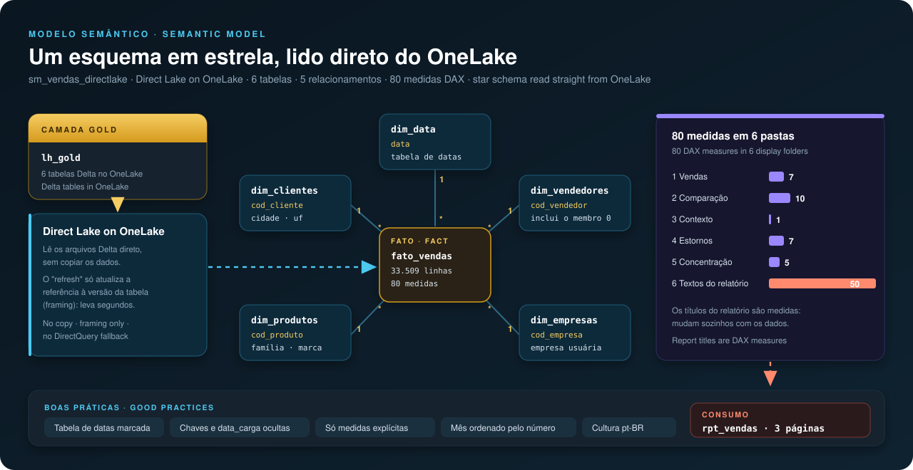
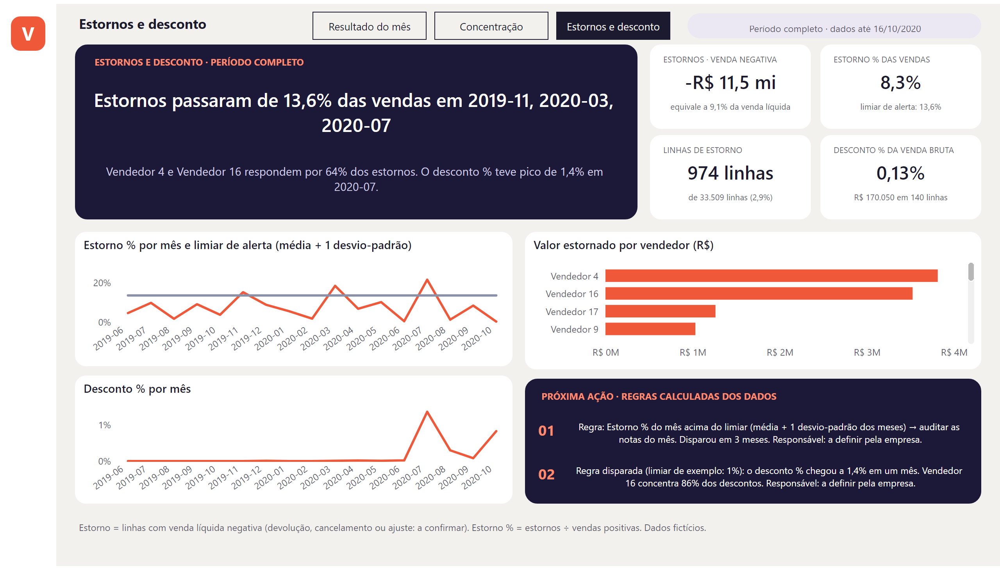
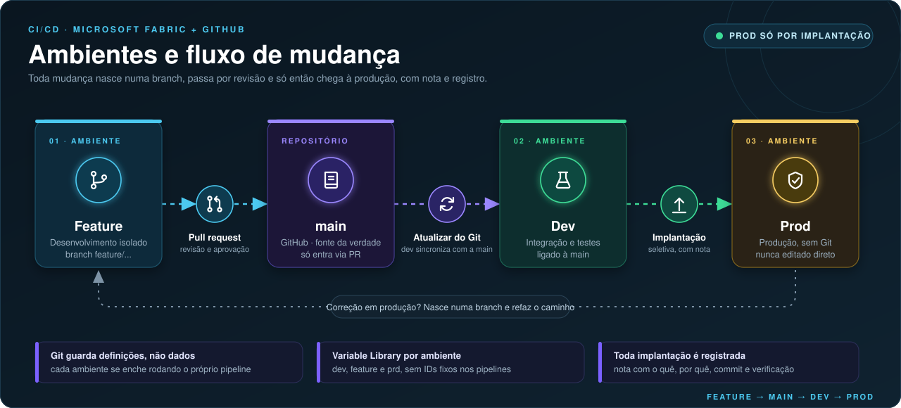
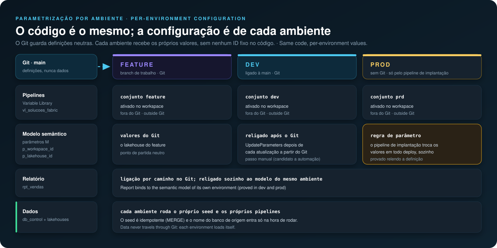
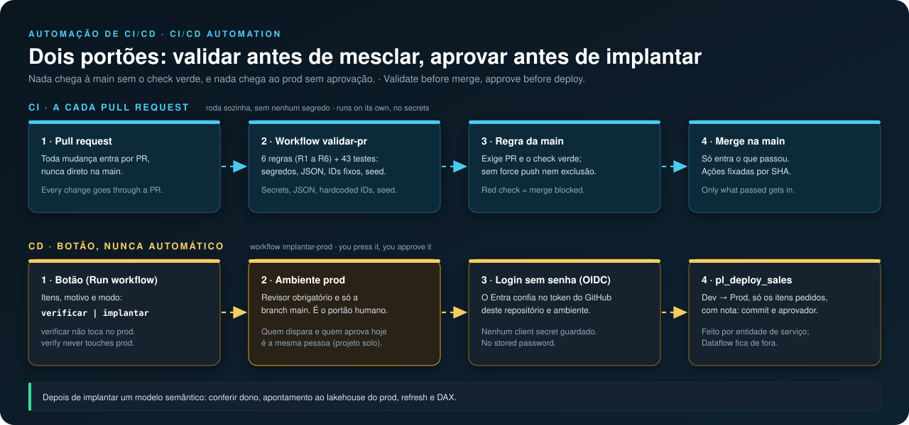
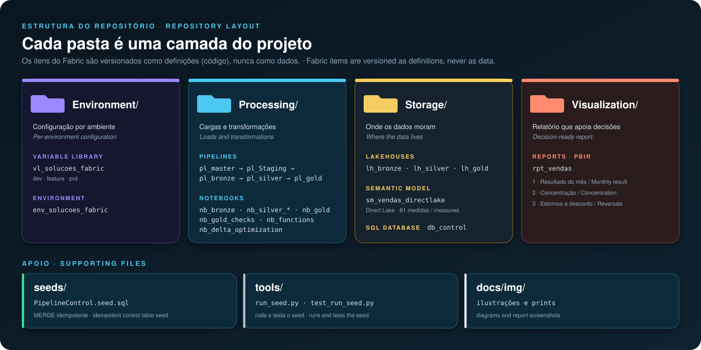

# sales-transformacoes-fabric

**Português** · [English](README.en.md)

Projeto de engenharia de dados no **Microsoft Fabric**, de ponta a ponta: da origem SQL Server até um **relatório Power BI que responde perguntas de negócio**. Arquitetura **medalhão** (bronze, silver, gold), três ambientes (**dev, feature e prod**) e promoção controlada por **Git, pull request e pipeline de implantação**. Os dados são fictícios.

A configuração das cargas não vem de planilha: vem de uma tabela de controle (`db_control`, um Fabric SQL Database). Para carregar uma tabela nova, basta uma linha nova nessa tabela, sem mexer em código.

## O que está entregue

| Etapa | Entrega | Onde está |
|---|---|---|
| Ingestão e camadas | Staging, Bronze, Silver e **Gold** (modelo em estrela) | `Processing/`, `Storage/Lakehouses` |
| Qualidade | `nb_gold_checks`: 28 verificações (chaves, reconciliação com a Silver, vendas órfãs, calendário) | `Processing/Notebooks` |
| Modelo semântico | `sm_vendas_directlake`: Direct Lake on OneLake, 6 tabelas, **81 medidas** em DAX | `Storage/Semantic Models` |
| Relatório | `rpt_vendas`: 3 páginas que respondem perguntas de negócio | `Visualization/Reports` |
| Ambientes | dev, feature e prod com Git, pull request e pipeline de implantação | veja abaixo |
| Automação de CI/CD | validação automática dos PRs e deploy com aprovação, sem senha guardada | `.github/workflows`, `tools/` |

## 1. Arquitetura de dados

<p align="center">
  
</p>

Os pipelines (`pl_Staging`, `pl_bronze`, `pl_silver`, `pl_gold`) são orquestrados pelo `pl_master` e guiados pelo `db_control`.

| Camada | O que guarda | Como é feita |
|---|---|---|
| Staging | cópia bruta da origem, em parquet | `pl_Staging` (atividade Copy) |
| Bronze | tabelas Delta iguais à origem | `pl_bronze` + `nb_bronze` |
| Silver | dados limpos, dimensões e fato | `pl_silver` + notebooks `nb_silver_*` |
| Gold | modelo em estrela: `fato_vendas` + `dim_clientes`, `dim_produtos`, `dim_vendedores`, `dim_empresas`, `dim_data` | `pl_gold` + `nb_gold` (um notebook genérico, guiado pelo `db_control`) |

Funções reutilizáveis, como o `safe_merge` (carga incremental idempotente), ficam em `nb_functions`. O `nb_delta_optimization` faz a manutenção das tabelas Delta (OPTIMIZE com V-Order e VACUUM) só com Spark SQL nativo.

## 2. Cargas guiadas pelo `db_control`

O arquivo `seeds/PipelineControl.seed.sql` insere as linhas de controle (40 hoje: Staging 13, Bronze 13, Silver 8, Gold 6) com `MERGE` pela chave **camada + entidade**: pode rodar várias vezes sem duplicar. O nome do banco de origem **não fica no arquivo**: entra como parâmetro na hora de rodar.

```python
from tools.run_seed import run_seed
run_seed("<nome do workspace>", "<nome do banco de origem>")
```

Requisitos: Python, `pyodbc`, ODBC Driver 18 for SQL Server e login do Azure CLI (`az login`). O teste `tools/test_run_seed.py` roda o seed duas vezes e confirma que o total de linhas não muda.

**Tabela nova = linhas novas no seed, sem mexer em código:**

1. Acrescente as linhas da tabela no `seeds/PipelineControl.seed.sql` (uma por camada).
2. Se for uma tabela Gold, acrescente uma função ao dicionário `TRANSFORMS` do `nb_gold`.
3. Faça o pull request e promova pelo fluxo de ambientes; rode o seed em cada ambiente e depois os pipelines.

Os pipelines percorrem o `db_control` com um `ForEach`; a linha nova passa a ser processada sozinha.

## 3. Qualidade e resiliência

- **Qualidade como teste:** o `nb_gold_checks` foi escrito **antes** do Gold (falhou primeiro e passou depois) e roda em qualquer ambiente.
- `retry` nas atividades que dependem de rede ou de capacidade, e `batchCount` para não estourar o limite de sessões Spark.
- Cargas idempotentes: rodar de novo não duplica dados.
- Manutenção Delta tolerante a falhas: uma tabela com problema não impede as outras, e o notebook falha no fim listando quais deram erro.

## 4. Modelo semântico

<p align="center">
  
</p>

O `sm_vendas_directlake` é a camada de **significado** entre o lakehouse e o relatório: diz como as tabelas se ligam e guarda as **contas** (medidas), para que um número saia igual em qualquer relatório.

- **Direct Lake on OneLake:** o modelo lê os arquivos Delta do `lh_gold` direto, **sem copiar** os dados. O "refresh" só atualiza a referência à versão da tabela (*framing*) e leva segundos. É o modo que a Microsoft recomenda para modelos novos, e não cai para DirectQuery.
- **Esquema em estrela:** `fato_vendas` no centro e cinco dimensões com relacionamentos **um-para-muitos** em sentido único. A `dim_data` é a tabela de datas do modelo.
- **81 medidas em 6 pastas:** vendas, comparação com mês e ano anterior, contexto, estornos, concentração (Pareto) e **textos do relatório**. Os títulos que concluem no relatório são medidas DAX: mudam sozinhos quando os dados mudam.
- **Boas práticas:** chaves técnicas e `data_carga` ocultas, só medidas explícitas, mês e dia da semana ordenados pelo número, cultura pt-BR.
- **Verificado:** a medida Vendas Líquidas bate com a soma da Silver, e cada ambiente foi conferido por consultas DAX depois de cada implantação.

## 5. O relatório: perguntas de negócio, não só gráficos

Cada página responde **uma** pergunta e segue a mesma ordem de leitura: **título que conclui**, a **causa**, o contexto do filtro, **indicadores com referência** (mês anterior e mesmo mês do ano anterior), o gráfico principal e a **próxima ação**, com uma regra calculada dos dados.

**Resultado do mês:** as vendas subiram ou caíram, e por quê?

<p align="center"></p>

**Concentração:** quem concentra a receita?

<p align="center"></p>

**Estornos e desconto:** onde as vendas são desfeitas e quando o desconto disparou?

<p align="center"></p>

Decisões de desenho:

- **Nenhum número inventado.** Os dados não têm meta nem custo, então a referência é sempre o período anterior. Os limiares das regras saem dos próprios dados (por exemplo, média + 1 desvio-padrão) ou vêm marcados como "limiar de exemplo".
- **Último mês completo.** Os dados vão até 16/10/2020; comparar um outubro de 16 dias com setembro mostraria uma queda falsa de 44%.
- **Contraste medido, não no olho.** Cada cor foi testada pela fórmula WCAG (texto ≥ 4,5:1, gráficos ≥ 3:1). Por isso o coral de destaque é mais escuro quando vira texto.
- **Verificado contra o DAX.** Os totais da tela batem com consultas DAX e SQL independentes (por exemplo, a ponte de variação fecha exatamente na variação do mês).

## 6. Ambientes e fluxo de mudança

<p align="center">
  
</p>

- **Feature:** onde cada pessoa desenvolve, ligada a uma branch própria. Nada vai direto para a `main`.
- **Dev:** ligado à `main`. Recebe o que foi aprovado no pull request.
- **Prod:** não tem Git. Só recebe mudanças pelo **pipeline de implantação** (`pl_deploy_sales`), por deploy seletivo e com **nota** (o quê, por quê, commit, verificação).
- O Git guarda **definições** (notebooks, pipelines, esquemas, modelo, relatório), nunca os **dados**. Cada ambiente se enche rodando o próprio pipeline.
- Corrigiu algo em produção? A correção também nasce numa branch, passa pelo pull request e pelo dev, e só então chega ao prod.

## 7. Parametrização por ambiente

<p align="center">
  
</p>

O código é o mesmo nos três ambientes; o que muda é a **configuração**, que nunca fica fixa no código:

- **Pipelines:** a **Variable Library** (`vl_solucoes_fabric`) tem um conjunto de valores por ambiente (`feature`, `dev`, `prd`). O conjunto ativo é uma configuração do workspace e **não vai no Git**.
- **Modelo semântico:** o Direct Lake **não se religa sozinho** ao lakehouse do ambiente seguinte. A fonte usa dois parâmetros M (`p_workspace_id` e `p_lakehouse_id`). No **prod**, uma **regra de parâmetro** do pipeline de implantação troca os valores em todo deploy. No **dev**, os parâmetros são religados depois de cada atualização a partir do Git. Os dois casos foram provados relendo a definição do modelo.
- **Relatório:** guarda no Git só a ligação por caminho e se religa sozinho ao modelo do mesmo ambiente.
- **Dados:** cada ambiente roda o próprio seed e os próprios pipelines. Os dados nunca passam pelo Git.

## 8. Automação de CI/CD

<p align="center">
  
</p>

A automação tem **dois portões**: nada entra na `main` sem o check verde, e nada chega ao prod sem aprovação. O Git e o pipeline de implantação (seção 6) continuam sendo o caminho; o GitHub Actions só automatiza e registra esse caminho.

**CI: validação a cada pull request** (`.github/workflows/validar-pr.yml`)

| Regra | O que verifica | Por quê |
|---|---|---|
| R1 | segredos no texto (senha, client secret, token, chave de conta, SAS, chave privada) | o repositório é público |
| R2 | JSON válido (`.json`, `.pbir`, `.pbism`, `.platform`) | um JSON quebrado impede o Fabric de atualizar a partir do Git |
| R3 | `workspaceId` zerado nos pipelines | um ID fixo apontaria o prod para o dev |
| R4 | GUID só onde é permitido (exceções justificadas no código) | o mesmo risco do R3, em qualquer arquivo |
| R5 | o seed mantém `$(SourceDatabase)` | o nome real do banco nunca entra no repositório |
| R6 | medida com nome de coluna e `VAR` com palavra reservada | dois erros de TMDL que já nos pegaram |

O workflow roda com permissão só de leitura e **sem nenhum segredo**, dispara em `pull_request` (nunca `pull_request_target`) e usa ações fixadas por SHA de commit. A regra da `main` (ruleset) exige pull request e o check `validar-pr` verde, e bloqueia exclusão e force push. Isso foi provado com um PR de teste com um JSON quebrado: o check ficou vermelho e o merge, bloqueado.

**CD: botão de deploy** (`.github/workflows/implantar-prod.yml`)

1. **Actions → implantar-prod → Run workflow**, com `itens` (`nome:Tipo`), `motivo` e `modo`.
2. O ambiente `prod` do GitHub exige a **aprovação** do revisor e só aceita a branch `main`.
3. O job entra no Azure por **OIDC**, sem senha guardada: o Entra confia no token do GitHub daquele repositório e ambiente. O app não tem client secret nem certificado.
4. `tools/implantar.py` chama a API do pipeline `pl_deploy_sales` (Dev para Prod) só para os itens pedidos, com uma **nota** que traz o motivo, o commit da `main`, quem disparou e quem aprovou.

Dois modos: `verificar` confere login, acesso, pipeline e itens **sem implantar**; `implantar` faz o deploy. O deploy é feito por uma entidade de serviço, e o `Dataflow` fica de fora porque a API não o aceita para esse tipo de identidade.

**O que a prática ensinou** (e está nos testes ou nas regras):

- A simulação (`validateOnly`) do deploy **não funciona** nesta conta: a API respondeu `InvalidOptions`. Por isso o modo seguro é `verificar`.
- Papel dado só a um **grupo** não valia para a entidade de serviço: ela precisou do papel direto (Admin no pipeline, Contributor nos dois workspaces).
- A credencial federada usa o formato **imutável** do subject do GitHub (com os IDs numéricos do dono e do repositório), que evita que um repositório recriado com o mesmo nome herde o acesso.
- O endereço de acompanhamento que a API devolve pode apontar para outro host; o script acompanha pelo ID da operação, e o token só viaja para `api.fabric.microsoft.com`.
- Quem dispara e quem aprova hoje é a **mesma pessoa** (projeto solo). A aprovação é um portão de confirmação, não uma segunda revisão.
- Um **modelo semântico** foi implantado pelo robô com uma diferença real (descrição de uma medida): dono, apontamento ao lakehouse do prod e DAX seguiram corretos. A prova cobre mudança de metadado; depois de cada deploy de modelo, conferir dono, apontamento, refresh e DAX.

## 9. Como criar um ambiente novo

1. **Criar o workspace** na capacidade do Fabric.
2. **Ligar ao Git** (dev e feature) ou **receber pelo pipeline de implantação** (prod).
3. **Ativar o conjunto de valores** da Variable Library correspondente ao ambiente.
4. **Rodar o seed** do `db_control` (seção 2).
5. **Rodar os pipelines**, um de cada vez: `pl_Staging`, `pl_bronze`, `pl_silver`, `pl_gold`.
6. **Conferir a qualidade** com o `nb_gold_checks`.

## 10. Segurança e boas práticas

- Repositório público: **sem senhas, tokens, connection strings ou nomes de sistemas reais**.
- Privilégio mínimo: poucos administradores; cada acesso com dono e motivo.
- Conexões à origem com usuário de leitura apenas.
- Toda implantação em produção tem nota e registro.

## 11. Estrutura do repositório

<p align="center">
  
</p>

```
Environment/     Environment e Variable Library
Processing/      Notebooks, pipelines e dataflow
Storage/         Lakehouses, modelo semântico e banco de controle
Visualization/   Relatório Power BI (PBIR)
.github/         Workflows: validar-pr (CI) e implantar-prod (CD)
seeds/           Seed do db_control
tools/           Seed, verificador do repositório e script de deploy (com testes)
docs/img/        Ilustrações e prints do relatório
```

Itens legados do projeto original (`sm_solucoes-fabric_*`, `nb_semantic_models`, `df_date`) ainda estão no repositório e serão aposentados depois de uma comparação de custo no Capacity Metrics.

## Documentação oficial

- [Git integration no Fabric](https://learn.microsoft.com/fabric/cicd/git-integration/intro-to-git-integration)
- [Deployment pipelines](https://learn.microsoft.com/fabric/cicd/deployment-pipelines/intro-to-deployment-pipelines)
- [Regras de implantação](https://learn.microsoft.com/fabric/cicd/deployment-pipelines/create-rules)
- [Variable libraries](https://learn.microsoft.com/fabric/cicd/variable-library/variable-library-overview)
- [Arquitetura medalhão](https://learn.microsoft.com/fabric/onelake/onelake-medallion-lakehouse-architecture)
- [Direct Lake](https://learn.microsoft.com/fabric/fundamentals/direct-lake-overview) e [parâmetros M com pipelines de implantação](https://learn.microsoft.com/fabric/fundamentals/direct-lake-develop#use-m-parameters-with-deployment-pipelines)
- [Federação de identidade para o GitHub Actions](https://learn.microsoft.com/entra/workload-id/workload-identity-federation-create-trust) e [subjects imutáveis](https://learn.microsoft.com/entra/workload-id/workload-identities-github-immutable-subjects)
- [Deploy Stage Content (API)](https://learn.microsoft.com/rest/api/fabric/core/deployment-pipelines/deploy-stage-content) e [automação de pipelines de implantação](https://learn.microsoft.com/fabric/cicd/deployment-pipelines/pipeline-automation-fabric)
- [Esquema em estrela no Power BI](https://learn.microsoft.com/power-bi/guidance/star-schema)
- [Formato PBIR do relatório](https://learn.microsoft.com/power-bi/developer/projects/projects-report)
