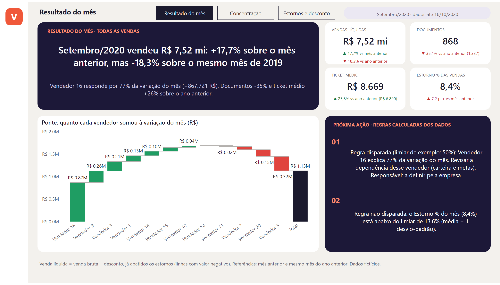
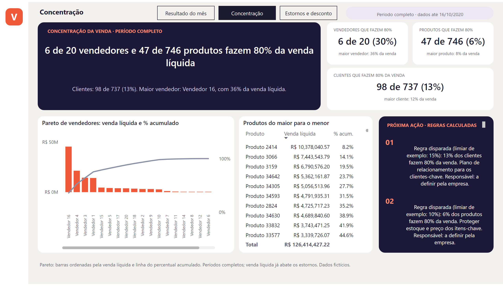

# sales-transformacoes-fabric

**Português** · [English](README.en.md)

Projeto de engenharia de dados no **Microsoft Fabric**, de ponta a ponta: da origem SQL Server até um **relatório Power BI que responde perguntas de negócio**. Arquitetura **medalhão** (bronze, silver, gold), três ambientes (**dev, feature e prod**) e promoção controlada por **Git, pull request e pipeline de implantação**. Os dados são fictícios.

A configuração das cargas não vem de planilha: vem de uma tabela de controle (`db_control`, um Fabric SQL Database). Para carregar uma tabela nova, basta uma linha nova nessa tabela, sem mexer em código.

## O que está entregue

| Etapa | Entrega | Onde está |
|---|---|---|
| Ingestão e camadas | Staging, Bronze, Silver e **Gold** (modelo em estrela) | `Processing/`, `Storage/Lakehouses` |
| Qualidade | `nb_gold_checks`: 28 verificações (chaves, reconciliação com a Silver, vendas órfãs, calendário) | `Processing/Notebooks` |
| Modelo semântico | `sm_vendas_directlake`: Direct Lake on OneLake, 6 tabelas, **80 medidas** em DAX | `Storage/Semantic Models` |
| Relatório | `rpt_vendas`: 3 páginas que respondem perguntas de negócio | `Visualization/Reports` |
| Ambientes | dev, feature e prod com Git, pull request e pipeline de implantação | veja abaixo |

## Arquitetura de dados

<p align="center">
  
</p>

Os pipelines (`pl_Staging`, `pl_bronze`, `pl_silver`, `pl_gold`) são orquestrados pelo `pl_master` e guiados pelo `db_control`.

| Camada | O que guarda | Como é feita |
|---|---|---|
| Staging | cópia bruta da origem, em parquet | `pl_Staging` (atividade Copy) |
| Bronze | tabelas Delta iguais à origem | `pl_bronze` + `nb_bronze` |
| Silver | dados limpos, dimensões e fato | `pl_silver` + notebooks `nb_silver_*` |
| Gold | modelo em estrela: `fato_vendas` + `dim_clientes`, `dim_produtos`, `dim_vendedores`, `dim_empresas`, `dim_data` | `pl_gold` + `nb_gold` (um notebook genérico, guiado pelo `db_control`) |

Funções reutilizáveis, como o `safe_merge` (carga incremental idempotente), ficam em `nb_functions`. O `nb_delta_optimization` faz a manutenção das tabelas Delta (OPTIMIZE com V-Order e VACUUM) só com Spark SQL nativo.

## O relatório: perguntas de negócio, não só gráficos

Cada página responde **uma** pergunta e segue a mesma ordem de leitura: **título que conclui**, a **causa**, o contexto do filtro, **indicadores com referência** (mês anterior e mesmo mês do ano anterior), o gráfico principal e a **próxima ação**, com uma regra calculada dos dados. Os títulos são medidas DAX: mudam sozinhos quando os dados mudam.

**1. Resultado do mês:** as vendas subiram ou caíram, e por quê?

<p align="center"></p>

**2. Concentração:** quem concentra a receita?

<p align="center"></p>

**3. Estornos e desconto:** onde as vendas são desfeitas e quando o desconto disparou?

<p align="center"></p>

Decisões de desenho:

- **Nenhum número inventado.** Os dados não têm meta nem custo, então a referência é sempre o período anterior. Os limiares das regras saem dos próprios dados (por exemplo, média + 1 desvio-padrão) ou vêm marcados como "limiar de exemplo".
- **Último mês completo.** Os dados vão até 16/10/2020; comparar um outubro de 16 dias com setembro mostraria uma queda falsa de 44%.
- **Contraste medido, não no olho.** Cada cor foi testada pela fórmula WCAG (texto ≥ 4,5:1, gráficos ≥ 3:1). Por isso o coral de destaque é mais escuro quando vira texto.
- **Verificado contra o DAX.** Os totais da tela batem com consultas DAX e SQL independentes (por exemplo, a ponte de variação fecha exatamente na variação do mês).

## Ambientes e fluxo de mudança

<p align="center">
  
</p>

- **Feature:** onde cada pessoa desenvolve, ligada a uma branch própria. Nada vai direto para a `main`.
- **Dev:** ligado à `main`. Recebe o que foi aprovado no pull request.
- **Prod:** não tem Git. Só recebe mudanças pelo **pipeline de implantação** (`pl_deploy_sales`), por deploy seletivo e com **nota** (o quê, por quê, commit, verificação).
- O Git guarda **definições** (notebooks, pipelines, esquemas, modelo, relatório), nunca os **dados**. Cada ambiente se enche rodando o próprio pipeline.
- Corrigiu algo em produção? A correção também nasce numa branch, passa pelo pull request e pelo dev, e só então chega ao prod.

## Parametrização por ambiente

- **Pipelines:** a **Variable Library** (`vl_solucoes_fabric`) tem um conjunto de valores por ambiente (`dev`, `feature`, `prd`). O conjunto ativo é uma configuração do workspace e **não vai no Git**.
- **Modelo semântico:** o Direct Lake **não se religa sozinho** ao lakehouse do ambiente seguinte. A fonte usa dois parâmetros M (`p_workspace_id` e `p_lakehouse_id`); no prod, uma **regra de parâmetro** do pipeline de implantação aponta o modelo para o lakehouse do prod. Isso foi provado relendo a definição do modelo depois de cada implantação.
- **Relatório:** implantado junto com o modelo, ele se religa ao modelo do mesmo ambiente.

## Como criar um ambiente novo

1. **Criar o workspace** na capacidade do Fabric.
2. **Ligar ao Git** (dev e feature) ou **receber pelo pipeline de implantação** (prod).
3. **Ativar o conjunto de valores** da Variable Library correspondente ao ambiente.
4. **Rodar o seed** do `db_control` (veja abaixo).
5. **Rodar os pipelines**, um de cada vez: `pl_Staging`, `pl_bronze`, `pl_silver`, `pl_gold`.
6. **Conferir a qualidade** com o `nb_gold_checks`.

## Seed do `db_control`

O arquivo `seeds/PipelineControl.seed.sql` insere as linhas de controle (40 hoje: Staging 13, Bronze 13, Silver 8, Gold 6) com `MERGE` pela chave **camada + entidade**: pode rodar várias vezes sem duplicar. O nome do banco de origem **não fica no arquivo**: entra como parâmetro na hora de rodar.

```python
from tools.run_seed import run_seed
run_seed("<nome do workspace>", "<nome do banco de origem>")
```

Requisitos: Python, `pyodbc`, ODBC Driver 18 for SQL Server e login do Azure CLI (`az login`). O teste `tools/test_run_seed.py` roda o seed duas vezes e confirma que o total de linhas não muda.

## Tabela nova = linhas novas no seed

1. Acrescente as linhas da tabela no `seeds/PipelineControl.seed.sql` (uma por camada).
2. Se for uma tabela Gold, acrescente uma função ao dicionário `TRANSFORMS` do `nb_gold`.
3. Faça o pull request e promova pelo fluxo acima; rode o seed em cada ambiente e depois os pipelines.

Os pipelines percorrem o `db_control` com um `ForEach`; a linha nova passa a ser processada sozinha.

## Resiliência e qualidade

- `retry` nas atividades que dependem de rede ou de capacidade, e `batchCount` para não estourar o limite de sessões Spark.
- Cargas idempotentes: rodar de novo não duplica dados.
- **Qualidade como teste:** o `nb_gold_checks` foi escrito **antes** do Gold (falhou primeiro e passou depois) e roda em qualquer ambiente.
- Manutenção Delta tolerante a falhas: uma tabela com problema não impede as outras, e o notebook falha no fim listando quais deram erro.

## Segurança e boas práticas

- Repositório público: **sem senhas, tokens, connection strings ou nomes de sistemas reais**.
- Privilégio mínimo: poucos administradores; cada acesso com dono e motivo.
- Conexões à origem com usuário de leitura apenas.
- Toda implantação em produção tem nota e registro.

## Estrutura do repositório

<p align="center">
  
</p>

```
Environment/     Environment e Variable Library
Processing/      Notebooks, pipelines e dataflow
Storage/         Lakehouses, modelo semântico e banco de controle
Visualization/   Relatório Power BI (PBIR)
seeds/           Seed do db_control
tools/           Script e teste do seed
docs/img/        Ilustrações e prints do relatório
```

Itens legados do projeto original (`sm_solucoes-fabric_*`, `nb_semantic_models`, `df_date`) ainda estão no repositório e serão aposentados depois de uma comparação de custo no Capacity Metrics.

## Documentação oficial

- [Git integration no Fabric](https://learn.microsoft.com/fabric/cicd/git-integration/intro-to-git-integration)
- [Deployment pipelines](https://learn.microsoft.com/fabric/cicd/deployment-pipelines/intro-to-deployment-pipelines)
- [Regras de implantação](https://learn.microsoft.com/fabric/cicd/deployment-pipelines/create-rules)
- [Variable libraries](https://learn.microsoft.com/fabric/cicd/variable-library/variable-library-overview)
- [Arquitetura medalhão](https://learn.microsoft.com/fabric/onelake/onelake-medallion-lakehouse-architecture)
- [Direct Lake](https://learn.microsoft.com/fabric/fundamentals/direct-lake-overview) e [parâmetros M com pipelines de implantação](https://learn.microsoft.com/fabric/fundamentals/direct-lake-develop#use-m-parameters-with-deployment-pipelines)
- [Formato PBIR do relatório](https://learn.microsoft.com/power-bi/developer/projects/projects-report)
