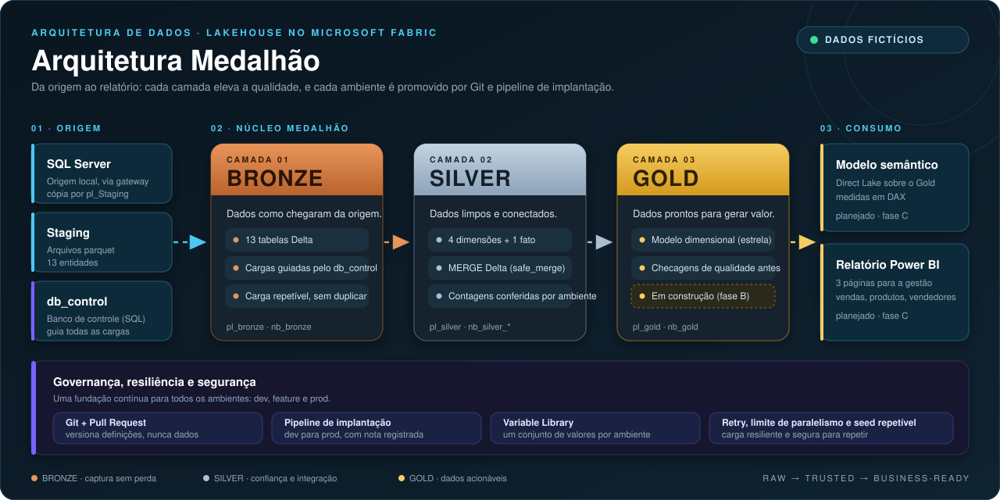
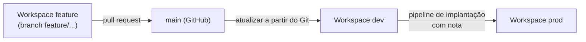

# sales-transformacoes-fabric

Projeto de engenharia de dados no **Microsoft Fabric** com arquitetura **medalhão** (bronze, silver, gold), três ambientes (**dev, feature e prod**) e promoção controlada por **Git, pull request e pipeline de implantação**. Os dados são fictícios.

A configuração das cargas não vem de planilha: vem de uma tabela de controle (`db_control`, um Fabric SQL Database). Para carregar uma tabela nova, basta uma linha nova nessa tabela, sem mexer em código.

## Arquitetura de dados

<p align="center">
  
</p>

Os pipelines (`pl_Staging`, `pl_bronze`, `pl_silver`, `pl_gold`) são orquestrados pelo `pl_master` e guiados pelo `db_control`.

| Camada | O que guarda | Como é feita |
|---|---|---|
| Staging | cópia bruta da origem, em parquet | `pl_Staging` (atividade Copy) |
| Bronze | tabelas Delta iguais à origem | `pl_bronze` + `nb_bronze` |
| Silver | dados limpos, dimensões e fato | `pl_silver` + notebooks `nb_silver_*` |
| Gold | tabelas prontas para análise | `pl_gold` (em construção) |

Funções reutilizáveis, como o `safe_merge` (carga incremental idempotente), ficam em `nb_functions`.

## Ambientes e fluxo de mudança



- **Feature:** onde cada pessoa desenvolve, ligada a uma branch própria. Nada vai direto para a `main`.
- **Dev:** ligado à `main`. Recebe o que foi aprovado no pull request.
- **Prod:** não tem Git. Só recebe mudanças pelo **pipeline de implantação** (`pl_deploy_sales`), por deploy seletivo e com **nota** (o quê, por quê, commit, verificação).
- O Git guarda **definições** (notebooks, pipelines, esquemas), nunca os **dados**. Cada ambiente se enche rodando o próprio pipeline.
- Corrigiu algo em produção? A correção também nasce numa branch, passa pelo pull request e pelo dev, e só então chega ao prod. O prod nunca é editado direto.

## Parametrização por ambiente

A **Variable Library** (`vl_solucoes_fabric`) tem um conjunto de valores por ambiente (`dev`, `feature`, `prd`). Os pipelines leem os valores dela, em vez de ter IDs fixos. O conjunto de valores ativo é uma configuração do workspace e **não vai no Git**, por isso é ativado na criação de cada ambiente.

## Como criar um ambiente novo

1. **Criar o workspace** na capacidade do Fabric.
2. **Ligar ao Git** (dev e feature) ou **receber pelo pipeline de implantação** (prod).
3. **Ativar o conjunto de valores** da Variable Library correspondente ao ambiente.
4. **Rodar o seed** do `db_control` (veja abaixo).
5. **Rodar os pipelines**, um de cada vez: `pl_Staging`, `pl_bronze`, `pl_silver`.

## Seed do `db_control`

O arquivo `seeds/PipelineControl.seed.sql` insere as linhas de controle com `MERGE` pela chave **camada + entidade**: pode rodar várias vezes sem duplicar. O nome do banco de origem **não fica no arquivo**: entra como parâmetro na hora de rodar.

```python
from tools.run_seed import run_seed
run_seed("<nome do workspace>", "<nome do banco de origem>")
```

Requisitos: Python, `pyodbc`, ODBC Driver 18 for SQL Server e login do Azure CLI (`az login`).

O teste `tools/test_run_seed.py` roda o seed duas vezes e confirma que o total de linhas não muda.

## Tabela nova = linhas novas no seed

Para incluir uma tabela da origem, **não se altera código**:

1. Acrescente as linhas da tabela no `seeds/PipelineControl.seed.sql` (uma por camada: staging, bronze, silver).
2. Faça o pull request e promova pelo fluxo acima.
3. Rode o seed em cada ambiente e depois os pipelines.

Os pipelines percorrem o `db_control` com um `ForEach`; a linha nova passa a ser processada sozinha.

## Resiliência

- `retry` nas atividades que dependem de rede ou de capacidade.
- `batchCount` limita quantas tabelas rodam ao mesmo tempo, para não estourar o limite de sessões Spark da capacidade.
- Cargas idempotentes: rodar de novo não duplica dados.

## Segurança e boas práticas

- Repositório público: **sem senhas, tokens, connection strings, IDs de workspace ou nomes de sistemas reais**.
- Privilégio mínimo: poucos administradores; cada acesso com dono e motivo.
- Conexões à origem com usuário de leitura apenas.
- Toda implantação em produção tem nota e registro.

## Estrutura do repositório

```
Environment/   Environment e Variable Library
Processing/    Notebooks e Pipelines
Storage/       Lakehouses, modelos semânticos e o banco de controle
seeds/         Seed do db_control
tools/         Script e teste do seed
```

## Documentação oficial

- [Git integration no Fabric](https://learn.microsoft.com/fabric/cicd/git-integration/intro-to-git-integration)
- [Deployment pipelines](https://learn.microsoft.com/fabric/cicd/deployment-pipelines/intro-to-deployment-pipelines)
- [Variable libraries](https://learn.microsoft.com/fabric/cicd/variable-library/variable-library-overview)
- [Arquitetura medalhão](https://learn.microsoft.com/fabric/onelake/onelake-medallion-lakehouse-architecture)
